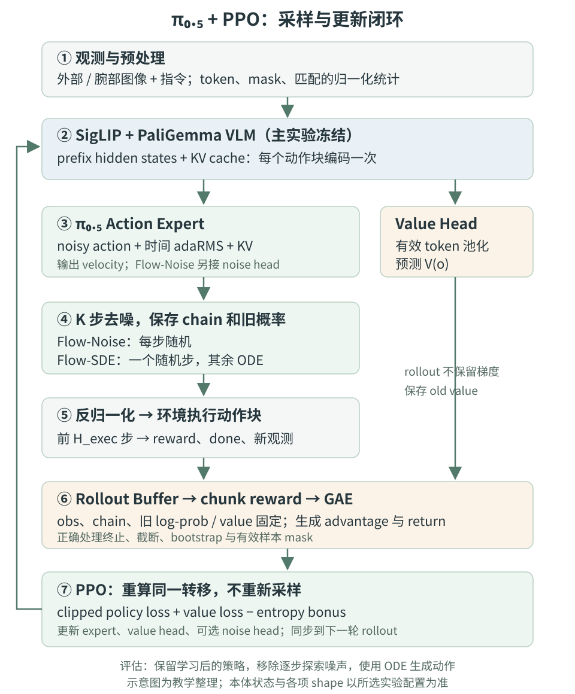

# π-RL：Flow Matching 与强化学习

[πRL 论文（本文核对版本：v2）](https://arxiv.org/html/2510.25889v2) · [官方 RLinf 实现](https://github.com/RLinf/RLinf)

第 1-5 节介绍方法；第 6-12 节将 π₀.₅ 的 PPO 训练串成完整 pipeline。代码部分固定到 RLinf 提交 `8d1535154a01c7701d938186424c620623acf1ae`（2026-10-15），它晚于论文，不能把当前默认配置直接当成论文原始实验设置。文中的数值算例与伪代码用于解释机制，不是实际训练结果。

## 1. Motivation

将 RL 用于基于 flow matching 的大规模 VLA（如 π₀、π₀.₅）时，面临一个根本性障碍：flow matching 生成的动作 log-likelihood 不可解析求解。 而现有 VLA-RL 工作（SimpleVLA-RL、RL4VLA 等）均建立在自回归 VLA 上（离散 softmax 或 Gaussian 参数化头），对 flow-based 模型完全不适用。

核心难点有二：
1. 给定初始噪声后，flow ODE 的逐步转移是确定性的，不能直接把这些转移当作具有普通高斯密度的 PPO 策略；初始高斯噪声仍使最终动作具有随机性，因此不能简单说整个 flow policy 完全没有探索。
2. 直接用 instantaneous change-of-variables（Hutchinson estimator）计算精确 log-likelihood 步数少时误差极大


## 2. 两个核心技术

### 2.1 Flow-Noise

**思路**：在每个 denoising step 注入一个**可学习噪声网络** $\sigma_{\theta'}$，将原来确定性的 Euler 步变成带随机性的高斯转移：

$$
p(\mathbf{A}^{\tau+\delta}|\mathbf{A}^{\tau}) \sim \mathcal{N}(\mu_\tau, \Sigma_\tau), \quad \mu_\tau = \mathbf{A}^\tau + \mathbf{v}^\tau \cdot \delta, \quad \Sigma_\tau = \text{diag}(\sigma_{\theta'}^2)
$$

由此将 denoising 过程建模为**离散时间 MDP**，整条 denoising 序列 $\mathcal{A} = (\mathbf{A}^0, \dots, \mathbf{A}^1)$ 的 log-likelihood 可精确分解为：

$$
\log \pi(\mathcal{A}|\mathbf{o}) = \log \pi(\mathbf{A}^0|\mathbf{o}) + \sum_{k=0}^{K-1} \log \pi(\mathbf{A}^{\tau_{k+1}} | \mathbf{A}^{\tau_k}, \mathbf{o})
$$

**额外噪声网络仅在训练时使用，评估时切回 ODE**。该思路借鉴 ReinFlow；不能把 ReinFlow 概括为“只使用固定噪声”。不再调用噪声头意味着无需额外的逐步噪声网络开销，但 ODE 仍可以从随机初始噪声启动。

原始 flow ODE 的 Euler 步本来就是完全确定性的，均值就是 $\mu_\tau$，方差为零。Flow-Noise 做的是在这个确定性步上叠加一个可学习的方差。

---

#### 原始 ODE vs Flow-Noise

标准 flow matching 的推理是 Euler 积分：$\mathbf{A}^{\tau+\delta} = \mathbf{A}^\tau + \mathbf{v}_\theta(\mathbf{A}^\tau, \mathbf{o}) \cdot \delta$

给定 $\mathbf{A}^\tau$，输出 $\mathbf{A}^{\tau+\delta}$ 是唯一确定的。转移概率退化为 Dirac delta：
$$
p(\mathbf{A}^{\tau+\delta} | \mathbf{A}^\tau) = \delta\!\left(\mathbf{A}^{\tau+\delta} - \underbrace{(\mathbf{A}^\tau + \mathbf{v}^\tau \cdot \delta)}_{\mu_\tau}\right)
$$

即 $\Sigma_\tau = 0$，这个条件转移没有可直接代入普通高斯公式的非退化密度。困难在于获得可用于 PPO 的 likelihood，而不是说随机初始噪声诱导出的最终动作分布不存在。
#### Flow-Noise 推导

##### Step 1：注入可学习噪声

引入噪声网络 $\sigma_{\theta'}(\mathbf{A}^\tau, \mathbf{o})$，将 Euler 步改写为随机转移：

$$
\boxed{p(\mathbf{A}^{\tau+\delta} | \mathbf{A}^\tau, \mathbf{o}) = \mathcal{N}(\mathbf{A}^{\tau+\delta};\, \mu_\tau,\, \Sigma_\tau)}
$$

其中：$\mu_\tau = \mathbf{A}^\tau + \mathbf{v}^\tau \cdot \delta, \qquad \Sigma_\tau = \text{diag}\!\left(\sigma_{\theta'}^2(\mathbf{A}^\tau, \mathbf{o})\right)$
采样实现：
$$
\mathbf{A}^{\tau+\delta} = \mu_\tau + \sigma_{\theta'} \odot \boldsymbol{\epsilon}, \quad \boldsymbol{\epsilon} \sim \mathcal{N}(\mathbf{0}, \mathbf{I})
$$

注意均值 $\mu_\tau$ 与原始 ODE 的 Euler 步一致，只是叠加了随机扰动。
##### Step 2：单步 log-likelihood

由 Gaussian 概率密度：

$$
\log p(\mathbf{A}^{\tau+\delta} | \mathbf{A}^\tau, \mathbf{o}) = -\frac{d}{2}\log(2\pi) - \sum_i \log \sigma_{\theta',i} - \frac{1}{2} \sum_i \frac{(\mathbf{A}^{\tau+\delta}_i - \mu_{\tau,i})^2}{\sigma_{\theta',i}^2}
$$

其中 $d$ 是本次计入 likelihood 的动作块展平维度，$i$ 遍历相应的动作时间位置和坐标；若计入完整预测块，则 $d=H_{\mathrm{pred}}D_{\mathrm{model}}$。

##### Step 3：将 denoising 建模为离散时间 MDP

离散化时间轴为 $K$ 步：$\tau_0=0, \tau_1=\delta, \ldots, \tau_K=1$，$\delta = 1/K$。

定义 denoising 序列 $\mathcal{A} = (\mathbf{A}^{\tau_0}, \mathbf{A}^{\tau_1}, \ldots, \mathbf{A}^{\tau_K})$，由 Markov 性：

$$
p(\mathcal{A} | \mathbf{o}) = p(\mathbf{A}^{\tau_0} | \mathbf{o}) \prod_{k=0}^{K-1} p(\mathbf{A}^{\tau_{k+1}} | \mathbf{A}^{\tau_k}, \mathbf{o})
$$

取 log，加法分解：

$$
\boxed{\log \pi(\mathcal{A} | \mathbf{o}) = \underbrace{\log p(\mathbf{A}^0 | \mathbf{o})}_{\log \mathcal{N}(\mathbf{0}, \mathbf{I})} + \sum_{k=0}^{K-1} \underbrace{\log \mathcal{N}\!\left(\mathbf{A}^{\tau_{k+1}};\, \mu_{\tau_k},\, \Sigma_{\tau_k}\right)}_{\text{Gaussian，精确可算}}}
$$

第一项是初始噪声的 log-prior（固定），第二项每一个都是标准 Gaussian log-likelihood，**全部精确可算**，无需 Hutchinson 估计。

##### Step 4：代入 PPO policy gradient

原来需要的梯度：

$$
\nabla_\theta \mathcal{J} = \mathbb{E}\left[\sum_t \nabla_\theta \log \pi_\theta(a_t | s_t) \cdot A(s_t, a_t)\right]
$$

Flow-Noise 的处理：将环境时间步 $t$ 处的 $\log \pi_\theta(a_t | s_t)$ 替换为 denoising 序列的联合 log-likelihood：

$$
\log \pi_\theta(a_t | s_t) \;\longleftarrow\; \log \pi(\mathcal{A}_t | \mathbf{o}_t) = \log p(\mathbf{A}_t^0) + \sum_{k=0}^{K-1} \log \mathcal{N}(\mathbf{A}_t^{\tau_{k+1}}; \mu_{\tau_k}, \Sigma_{\tau_k})
$$

这是在扩展随机变量空间中使用 score-function 梯度：奖励依赖最终动作，对完整采样链求梯度可优化相同的期望回报。**联合链的密度并不等于最终动作的边缘密度**；该梯度关系也不意味着两种空间里的 PPO clipping 目标逐项相同。

PPO 的 importance sampling ratio 也因此变为：

$$
r_\theta = \frac{\pi_\theta(\mathcal{A}_t | \mathbf{o}_t)}{\pi_{\theta_\text{old}}(\mathcal{A}_t | \mathbf{o}_t)} = \prod_{k=0}^{K-1} \frac{\mathcal{N}(\mathbf{A}^{\tau_{k+1}}; \mu_{\tau_k}^\theta, \Sigma_{\tau_k}^\theta)}{\mathcal{N}(\mathbf{A}^{\tau_{k+1}}; \mu_{\tau_k}^{\theta_\text{old}}, \Sigma_{\tau_k}^{\theta_\text{old}})}
$$

各条件高斯项可以解析计算，但直接连乘可能溢出或下溢。实现应先做 log-prob 差再取指数，并监控 KL 与 clip fraction；第 10 节还会区分论文的完整求和与官方代码中的归约。

---
> 推理时的处理

噪声网络 $\sigma_{\theta'}$ 在训练结束后**直接丢弃**：
$$
\mathbf{A}^{\tau+\delta}\big|_{\text{inference}} = \mathbf{A}^\tau + \mathbf{v}_\theta(\mathbf{A}^\tau, \mathbf{o}) \cdot \delta
$$
退化回原始 ODE 去噪路径，不再调用额外噪声头。这里的“确定性”指给定初始噪声后的积分过程；实际速度仍取决于去噪步数、硬件及实现。

### 2.2 Flow-SDE

**思路**：在 ODE/SDE 对应关系下加入扩散项，同时修正 drift。只给 Euler 步加固定噪声而不改均值，不是这里的 Flow-SDE。

时间方向必须一致：前文用 $\tau:0\to1$ 表示“噪声到动作”；官方 OpenPI 代码用 $u:1\to0$。两者满足 $u=1-\tau$，对应速度满足 $w_u=-v_\tau$。为避免混用符号，下面直接写核对过的代码坐标形式，令正步长 $\Delta=u_k-u_{k+1}>0$：

$$
\widehat A=X_u-u w_\theta(X_u,u,o),\qquad
\widehat\epsilon=X_u+(1-u)w_\theta(X_u,u,o).
$$

$$
\mu_k=(1-u+\Delta)\widehat A+
\left(u-\Delta-\frac{g_u^2\Delta}{2u}\right)\widehat\epsilon,
\qquad s_k=g_u\sqrt{\Delta}.
$$

$$
X_{u-\Delta}=\mu_k+s_k\epsilon_k,\qquad \epsilon_k\sim\mathcal N(0,I).
$$

内部时间点采用 $g_u=a\sqrt{u/(1-u)}$。在 $u=1$ 处这个表达式奇异，官方 `sample_mean_var` 用下一离散时间点替换分母中的 1 来处理端点，而不是直接除以零。连续时间下的边缘分布对应关系也不保证有限步 Euler 采样、学习误差及混合采样下的分布完全相同。依据：[采样器源码](https://github.com/RLinf/RLinf/blob/8d1535154a01c7701d938186424c620623acf1ae/rlinf/models/embodiment/openpi/sampling/rl_sampler.py)。

在此基础上构建**两层 MDP**（two-layer MDP）：
- **内层**：denoising 步之间的转移（$\tau < 1$），状态为 $\bar{s}_t^\tau = (\mathbf{o}_t, \mathbf{A}_t^\tau)$
- **外层**：$\tau = 1$ 时执行最终动作 $\mathbf{A}_t^1$ 与环境交互，获得 reward，并重置为新 observation

奖励结构：$\tau < 1$ 时 reward 为 0，只在 $\tau = 1$ 完成环境交互后给予 $R_\text{ENV}$。

还引入 **Hybrid ODE-SDE 采样**：每次生成动作块时，随机选择一个去噪步使用 SDE，其余步使用 ODE；更新时只重算被选择的随机转移。它不是固定的“前段 ODE、后段 SDE”。完整链仍需生成，节省的主要是 PPO 重算与反向传播开销。

---

## 3. 策略优化

两种方案都接入 **PPO**，需要 critic 辅助估计 advantage $A(s_t, a_t) = Q(s_t, a_t) - V(s_t)$。

critic 的设计是 ablation 的重点之一，论文对 critic 架构做了专项消融分析。

---

## 4. 架构关系总结

```
π₀ / π₀.₅ (SFT baseline)
       ↓  freeze/fine-tune VLM backbone
   Flow-Noise 分支                Flow-SDE 分支
  [注入可学习噪声网络]           [ODE → SDE 转换]
  [离散时间 MDP]                [两层 MDP]
       ↓                              ↓
   PPO (+ critic)            PPO (+ critic)
       ↓
   π_RL (推理时噪声丢弃 / 标准 ODE 采样)
```

---

## 5. 实验结论与适用范围

论文 v2 的 LIBERO 表 1 中，π₀.₅ few-shot SFT 的平均成功率为 77.1%，Flow-SDE 与 Flow-Noise 分别达到 97.9% 和 98.3%；同表的 full-dataset π₀.₅ SFT baseline 为 96.9%。这些是指定 benchmark、checkpoint 和评估协议下的结果，不代表任意机器人任务都能得到相同增益。[论文实验部分](https://arxiv.org/html/2510.25889v2#S5)。

这意味着该方法的核心价值在于：
- **数据效率**：少量 SFT 数据 + RL 可媲美大量 SFT
- **泛化性**：论文还评估了视觉、指令和任务变化下的表现；这类结果需要按具体测试集比较，不能直接外推到任意真实环境。
- **通用性**：同一框架适配 π₀ / π₀.₅ / GR00T N1.5（本文采用的 v2 中见 Appendix C）。

## 6. π₀.₅ + PPO：先确定训练对象

### 6.1 从哪个 checkpoint 开始

完整顺序是：π₀.₅ 预训练模型 → 目标环境上的 SFT → πRL 在线 PPO → ODE 评估。PPO 阶段从已经能偶尔成功完成任务的 SFT 模型开始，通过环境奖励提高成功率，不是从随机初始化的动作专家开始。

本文以 **LIBERO-Spatial、π₀.₅、chunk-level PPO** 为具体例子。论文主实验冻结 VLM、训练约 300M 参数的动作专家；新增的 value head 和 Flow-Noise 分支的 noise head 也需要学习。SFT 阶段则微调整个模型。依据：[论文 §5.1、§5.2.1](https://arxiv.org/html/2510.25889v2#S5)。

| 模块 | 输入与输出 | PPO 阶段的作用 |
|---|---|---|
| SigLIP + PaliGemma VLM | 图像、指令 → prefix hidden states / KV cache | 主实验冻结，提供观测条件 |
| π₀.₅ action expert | noisy action、时间条件、prefix KV → velocity | Actor 的主要可训练部分 |
| action/time projections | 动作与时间的输入投影、速度输出投影 | 随 action expert 路径学习 |
| ValueHead | VLM prefix 特征 → 标量 $V_\phi(o)$ | 学习剩余回报基线 |
| ExploreNoiseNet | expert hidden states → 每坐标标准差 | 仅 Flow-Noise 使用 |

“共享 Actor-Critic”在这里指共享观测编码器，不代表 critic 直接输出动作，也不代表冻结 VLM 后 value head 一并冻结。[模型构建与冻结](https://github.com/RLinf/RLinf/blob/8d1535154a01c7701d938186424c620623acf1ae/rlinf/models/embodiment/openpi/__init__.py)和 [Pi0RL](https://github.com/RLinf/RLinf/blob/8d1535154a01c7701d938186424c620623acf1ae/rlinf/models/embodiment/openpi/tasks/rl.py)可以相互核对。

### 6.2 两个容易误加的模块

**本体状态**：π₀.₅ 架构可以把离散化状态放进 prompt，但 πRL 论文的 LIBERO / ManiSkill 主实验明确省略了该输入。环境观测字典中出现 `state`，并不能证明真实状态已经进入神经网络；它还可能用于接口、动作变换或被预处理替换。当前代码的行为要核对所选 checkpoint 对应的 OpenPI `TrainConfig` 与 transforms，不能只看一个 `use_proprio` 字段。

**高层文本规划与 FAST**：π₀.₅ 预训练中有文本与 FAST 动作表示，不等于这里的每个 PPO rollout 都先生成一段子任务文本，再对文本 token 做 PPO。本文核对的 RL 路径将任务指令作为条件，通过连续 flow expert 采样动作；`prev_logprobs` 是高斯转移的密度，不是语言模型词表 softmax。增加高层规划器属于额外系统设计，不是以下流程的默认步骤。

### 6.3 一张图看清数据与梯度



图中 rollout 全程不保留梯度；PPO update 对保存的同一批去噪转移重新前向，梯度流向动作专家、value head，以及适用时的 noise head。环境仿真和旧策略采样结果均不参与反向传播。

## 7. 从原始观测到动作分布

### 7.1 先分清三种“时间”与两种动作维度

| 符号 | 含义 | 本文代码示例 |
|---|---|---|
| $t$ | 第几个环境宏步 / action chunk | 执行一段动作后才加一 |
| $h$ | 一个 chunk 内的机器人控制步 | $0,\ldots,H_{\mathrm{exec}}-1$ |
| $k$ / $u_k$ | 去噪离散步 / flow 时间 | $K=3$，$u=[1,2/3,1/3,0]$ |
| $H_{\mathrm{pred}}$ | 网络一次预测的动作长度 | 由 checkpoint / TrainConfig 决定 |
| $H_{\mathrm{exec}}$ | 本轮实际送给环境的长度 | Spatial 示例为 5 |
| $D_{\mathrm{model}}$ | 网络内部统一动作维度 | 32，含 padding |
| $D_{\mathrm{env}}$ | 环境需要的动作坐标数 | LIBERO 示例为 7 |

**$H_{\mathrm{pred}}$、$H_{\mathrm{exec}}$ 和 $K$ 是三个独立参数。** 当前官方文档的 `pi05_libero` 示例网络 horizon 为 10，Spatial 配置执行其中前 5 步、用 3 步去噪；具体值仍以实际加载的配置为准。`num_action_chunks` 在这套接口中表示执行长度，并不等于一次 rollout 有多少个 PPO 样本。[horizon 解析代码](https://github.com/RLinf/RLinf/blob/8d1535154a01c7701d938186424c620623acf1ae/rlinf/models/embodiment/openpi/__init__.py)；[官方说明](https://rlinf.readthedocs.io/en/latest/rst_source/examples/embodied/pi0.html)。

### 7.2 观测预处理与 prefix cache

1. 从环境读取外部相机、腕部相机和任务指令，按训练时相同的键名、相机顺序、图像尺寸及方向重排。
2. 应用 checkpoint 对应的 normalization、tokenizer、padding 和 image/prompt masks。动作反归一化必须使用同一套统计量。
3. SigLIP 将图像编码成视觉 token；文本 token 经词嵌入，与视觉 token 形成 prefix。
4. VLM 前向得到 `prefix_out`、`prefix_mask` 和 `kv_cache`。一次动作块的所有去噪步共享同一观测，所以这份 KV cache 可以复用。
5. 对有效 prefix token 做 masked pooling，输入 value head 得到 $V_\phi(o_t)$。当前默认模式是 `mean_token`，不是对 padding token 无差别取平均。

$$
z_t=\frac{\sum_i m_{t,i}h_{t,i}}{\max(1,\sum_i m_{t,i})},
\qquad V_\phi(o_t)=\operatorname{MLP}_\phi(z_t).
$$

主实验冻结 VLM 时，缓存构建可以在 `no_grad` 下进行；value head 的前向仍必须在更新阶段保留自己的梯度。若以后连 VLM 一起训练，不能跨优化器更新继续使用旧权重生成的 cache。[prefix/value 实现](https://github.com/RLinf/RLinf/blob/8d1535154a01c7701d938186424c620623acf1ae/rlinf/models/embodiment/openpi/sampling/rl_sampler.py)。

### 7.3 π₀.₅ 动作专家的单步前向

初始化 $X_0\sim\mathcal N(0,I)$，形状为 $[B,H_{\mathrm{pred}},D_{\mathrm{model}}]$。这里 $X_k$ 的下标是去噪步编号，因此 $X_0$ 对应代码时间 $u_0=1$，$X_K$ 对应 $u_K=0$。

每步先将 $X_k$ 经 action projection 得到 action tokens；将 $u_k$ 做正弦时间嵌入和 MLP，作为 **adaRMS 条件**送进 π₀.₅ action expert。expert 读取 prefix KV 后输出 hidden states，再经 action output projection 得到 $w_\theta(X_k,u_k,o_t)$。这个速度张量与 $X_k$ 同形状。

π₀.₅ 的时间条件路径与 π₀ 的 action/time 拼接路径不同，不能直接照搬 π₀ 的 suffix 代码。[`embed_suffix`、`build_prefix_cache`、`run_suffix`](https://github.com/RLinf/RLinf/blob/8d1535154a01c7701d938186424c620623acf1ae/rlinf/models/embodiment/openpi/pi0.py)。

## 8. Rollout：把采样链与真实奖励存下来

### 8.1 Flow-Noise：每个去噪步都随机

在代码的反向时间坐标下，$\Delta=1/K>0$，单步为：

$$
\mu_{t,k}=X_{t,k}-\Delta w_{\theta_{\mathrm{old}}}(X_{t,k},u_k,o_t),
\qquad s_{t,k}=\operatorname{NoiseHead}_{\eta_{\mathrm{old}}}(h^{\mathrm{expert}}_{t,k}),
$$

$$
X_{t,k+1}=\mu_{t,k}+s_{t,k}\odot\epsilon_{t,k}.
$$

Noise head 实际依赖 expert hidden states，因而间接依赖观测、时间与 noisy action。`noise_logvar_range` 的名字容易误导：当前 `ExploreNoiseNet.set_noise_range` 将传入端点当作**标准差范围**，先平方再取对数；例如 `[0.04, 0.10]` 约束的是 std，不是把 log-variance 直接限制在两个正数之间。[噪声头源码](https://github.com/RLinf/RLinf/blob/8d1535154a01c7701d938186424c620623acf1ae/rlinf/models/embodiment/modules/explore_noise_net.py)。

### 8.2 Flow-SDE：一个随机步，其余步为 ODE

随机选 $k_*$。当 $k=k_*$ 时，使用第 2.2 节的 SDE 均值和标准差；其余步采用 $X_{k+1}=X_k-\Delta w_\theta$。`joint_logprob=False` 时，PPO 只评价所保存的 $(X_{k_*},X_{k_*+1},k_*)$。

选中步之外的 ODE 转移不是“方差为零的普通高斯”。代码让这些位置的 log-prob 返回 0 是 bookkeeping，不代表 Dirac 转移的真实 log-density 为 0。另一个实现细节是，当前 `_predict_train` 一次调用会为整批样本共享一个随机选择的步号；不能默认每个 batch 元素独立抽一个步号。[rollout 与重算入口](https://github.com/RLinf/RLinf/blob/8d1535154a01c7701d938186424c620623acf1ae/rlinf/models/embodiment/openpi/tasks/rl.py)。

### 8.3 从模型空间到环境空间

生成 $X_K$ 后，通过 output transforms 反归一化、去掉 padding 并按环境接口处理动作，只执行前 $H_{\mathrm{exec}}$ 步，然后重新观察环境。不要把 32 维归一化动作直接送给 LIBERO，也不要在已经是 delta action 的数据上重复做 delta 变换。

Gaussian log-prob 在**模型采样空间**中计算，使用保存的 noisy-action 转移。不要事后用经过反归一化、夹持或裁剪的环境 action 替换 `chains_next`。非可逆后处理尤其不能当成同一高斯随机变量。[动作变换](https://github.com/RLinf/RLinf/blob/8d1535154a01c7701d938186424c620623acf1ae/rlinf/models/embodiment/openpi/transforms/pipeline.py)；[LIBERO 数据约定](https://github.com/RLinf/RLinf/blob/8d1535154a01c7701d938186424c620623acf1ae/rlinf/models/embodiment/openpi/dataconfig/libero_dataconfig.py)。

### 8.4 Rollout buffer 应保存什么

| 数据 | 单次模型调用的典型形状 | 后续用途 |
|---|---|---|
| 原始图像、prompt token/mask | 按 observation 结构保存 | 更新时重建同一观测 |
| `chains` | $[B,K+1,H_{\mathrm{pred}},32]$ | 保存全部 noisy states，而不只是最终 action |
| `denoise_inds` | $[B,K]$ | 标明需要评价的去噪步 |
| `prev_logprobs` | $[B,H_{\mathrm{exec}},7]$ | 与新 log-prob 比较；尚未做 chunk 求和 |
| `prev_values` | $[B,1]$ | TD error、GAE 和 value clipping |
| chunk 内奖励、done 等标志 | 每个执行步一项 | 聚合 macro reward、构造 mask |
| 最后一条观测 / bootstrap value | 每条 rollout 的尾部 | rollout 截断时估计未观察到的剩余回报 |

虽然 Flow-SDE 只用一个随机转移做更新，这个版本仍保存完整 `chains`。因此“只存一对状态”是可以考虑的进一步内存优化，不是当前实现事实。

## 9. 环境奖励如何变成 GAE 与 critic target

### 9.1 chunk-level MDP

一个 macro-step 包含 $H_{\mathrm{exec}}$ 个控制步，论文使用：

$$
R_t=\sum_{h=0}^{H_{\mathrm{exec}}-1}r_{t,h}.
$$

后续 $\gamma$ 是 macro-step 的折扣。不能一边沿用这个定义，一边不加说明地改成 $\gamma^{H_{\mathrm{exec}}}$；如果希望从每控制步的折扣推导 semi-MDP，就要同时重新定义折扣和 chunk 内奖励聚合。LIBERO 成功奖励通常为二元反馈，具体 done、成功后持续奖励与 reset 规则仍由环境 wrapper 决定。

### 9.2 TD error、优势与回报目标

用旧 value 计算，并在一个 PPO 更新批次内保持固定。令 $b_t$ 表示是否允许 bootstrap，$c_t$ 表示 GAE 能否跨到下一条样本：

$$
\delta_t=R_t+\gamma b_tV_{\phi_{\mathrm{old}}}(o_{t+1})
-V_{\phi_{\mathrm{old}}}(o_t),
$$

$$
\widehat A_t=\delta_t+\gamma\lambda c_t\widehat A_{t+1},
\qquad \widehat G_t=\widehat A_t+V_{\phi_{\mathrm{old}}}(o_t).
$$

真正终止时不 bootstrap；只因采样窗口结束而截断、且任务并未结束时，可以用最后真实观测的 value bootstrap；遇到 reset 不应把下一 episode 的优势串过来。时间上限是否按终止处理要遵循环境任务定义。RLinf 当前 GAE 核心使用传入 `dones[step+1]` 同时控制 TD bootstrap 与递推；所以终止语义和可能的奖励修正必须在送入 GAE 前与环境侧对齐，不能仅替换递推公式。[GAE 源码](https://github.com/RLinf/RLinf/blob/8d1535154a01c7701d938186424c620623acf1ae/rlinf/algorithms/advantages.py)。

先计算未标准化的 $\widehat A_t$ 与 $\widehat G_t$，再对有效样本的优势做标准化。**critic 的 target 不能用标准化后的优势加旧 value 重建**，否则会改变回报的尺度。

### 9.3 一次可手算的更新信号

假设最后一个 chunk 获得奖励 1 并终止，旧 value 为 0.4，则 $\delta_t=\widehat A_t=0.6$，critic target 为 1。前一个 chunk 的奖励为 0、旧 value 为 0.3，取 $\gamma=0.99,\lambda=0.95$：

$$
\delta_{t-1}=0+0.99\times0.4-0.3=0.096,
$$

$$
\widehat A_{t-1}=0.096+0.99\times0.95\times0.6=0.6603.
$$

因此前一个没有即时奖励的动作块仍会得到正向学习信号。这是 sparse reward 通过 critic 和 GAE 向前传播的具体过程，不需要为每个去噪步虚构一个机器人任务奖励。

## 10. PPO update：同一份链，重新计算概率

### 10.1 什么固定，什么重新计算

固定旧 rollout 的 $o_t$、$X_{t,k}$、$X_{t,k+1}$、$k_*$、旧 log-prob、旧 value、优势和 target。新策略只重新计算这些固定输入下的 velocity、Gaussian 参数、log-prob 与 value。

$$
\ell^{\mathrm{new}}_{t,k}=
\log\mathcal N\left(X^{\mathrm{old}}_{t,k+1};
\mu_\theta(X^{\mathrm{old}}_{t,k},o_t),
\operatorname{diag}(s_\theta^2)\right).
$$

**更新时重新采样一条新链，再与旧链的 log-prob 相除，是错误的。** PPO ratio 的分子和分母必须评价同一个已发生的采样结果。新 Gaussian 的参数保留梯度，但旧状态、旧采样值和 GAE target 必须 detach。

### 10.2 论文联合密度与官方 reduction 的区别

完整链的理论 log-density 为：

$$
\ell_t^{\mathrm{joint}}=
\ell_t^{\mathrm{prior}}+
\sum_{k=0}^{K-1}\sum_{h=0}^{H_{\mathrm{pred}}-1}
\sum_{d=0}^{D_{\mathrm{model}}-1}\ell_{t,k,h,d}.
$$

初始标准正态 prior 与参数无关，在 new/old 的 log-ratio 中抵消。但当前 `Pi0RL` 的 Flow-Noise 路径先截取执行长度和环境动作维度，并在包含 prior 的 $K+1$ 个项上 **取平均**；接着 chunk-level loss 再对动作位置和坐标求和。因此代码实际使用的标量是：

$$
\widetilde\ell_t=
\sum_{h=0}^{H_{\mathrm{exec}}-1}\sum_{d=0}^{D_{\mathrm{env}}-1}
\frac{\ell^{\mathrm{prior}}_{t,h,d}+
\sum_{k=0}^{K-1}\ell_{t,k,h,d}}{K+1}.
$$

这里不能把 `mean(dim=1)` 写成“联合概率按定义就是取平均”。在相同纳入坐标范围下，它把完整乘积 ratio 变成其 $1/(K+1)$ 次幂，会改变 PPO clipping 的有效尺度；对剩余预测位置 / padding 坐标的排除也是实现选择，不能宣称它就是完整最终动作边缘概率。复现代码时应使 old/new 的裁剪范围与 reduction 完全一致。

Flow-SDE 的 `joint_logprob=False` 路径则选中 $k_*$ 的单个转移，再对前 $H_{\mathrm{exec}}$ 步和 $D_{\mathrm{env}}$ 个坐标求和，没有这个 $K+1$ 平均。对应：[模型侧 reduction](https://github.com/RLinf/RLinf/blob/8d1535154a01c7701d938186424c620623acf1ae/rlinf/models/embodiment/openpi/tasks/rl.py)；[loss 输入归约](https://github.com/RLinf/RLinf/blob/8d1535154a01c7701d938186424c620623acf1ae/rlinf/algorithms/utils.py)。

### 10.3 Actor、Critic 与熵项

以选定且一致的 log-prob 定义计算：

$$
\rho_t=\exp(\ell_t^{\mathrm{new}}-\ell_t^{\mathrm{old}}),
$$

$$
L_\pi=-\mathbb E_t\left[
\min\left(\rho_t\widehat A_t,
\operatorname{clip}(\rho_t,1-\epsilon,1+\epsilon)\widehat A_t\right)
\right].
$$

若某个有效样本的正优势为 0.6、log-ratio 为 0.3，则 $\rho\approx1.350$；$\epsilon=0.2$ 时两个 surrogate 为 0.810 和 0.720，取较小者 0.720。PPO 因而不再鼓励该样本的概率无限增加。负优势时的裁剪方向也由同一个 `min` 决定。

critic 拟合固定 target $\widehat G_t$。教学上常写均方误差，但当前官方实现使用 **clipped value + Huber loss**：

$$
V_t^{\mathrm{clip}}=V_t^{\mathrm{old}}+
\operatorname{clip}(V_t-V_t^{\mathrm{old}},-\epsilon_V,\epsilon_V),
$$

$$
L_V=\mathbb E_t\left[
\max\{\operatorname{Huber}(\widehat G_t-V_t),
\operatorname{Huber}(\widehat G_t-V_t^{\mathrm{clip}})\}\right].
$$

该版本 `actor_critic` 先相加 $L_\pi+L_V$，worker 再减去配置的 entropy bonus。Flow-Noise 的熵项来自条件高斯标准差，鼓励探索；它不是最终动作边缘分布的精确熵。Flow-SDE 示例的熵系数为 0。代码随后做梯度累积、梯度裁剪和优化器更新。[PPO losses](https://github.com/RLinf/RLinf/blob/8d1535154a01c7701d938186424c620623acf1ae/rlinf/algorithms/losses.py)；[训练 worker](https://github.com/RLinf/RLinf/blob/8d1535154a01c7701d938186424c620623acf1ae/rlinf/workers/actor/embodied_fsdp_actor_worker.py)。

### 10.4 梯度最后流向哪里

正优势倾向提高旧采样转移在新策略下的密度，负优势倾向降低该密度。对 Flow-Noise，密度可通过移动均值和调整标准差改变；其梯度分别经过 velocity 路径和 noise head。value loss 更新 value head。主实验冻结 VLM，因此这里不会把 reward 通过图像编码器继续反传。

一次 buffer 可以重复做配置指定的 PPO update epochs；但旧 log-prob、旧 value 和 GAE target 不应在每个 minibatch 后刷新。完成本轮后同步 actor 到 rollout 模型，再采一批新的 on-policy 数据。[训练闭环](https://github.com/RLinf/RLinf/blob/8d1535154a01c7701d938186424c620623acf1ae/rlinf/runners/embodied_runner.py)。

## 11. 从论文到可实现的伪代码

下面是**语义伪代码**，省略分布式通信与张量搬运；函数名用于说明职责，不是可直接复制运行的 RLinf API。`reduce_logp` 必须采用第 10.2 节明确选定的规则。

### 11.1 收集 rollout

```python
load_sft_checkpoint_and_matching_transforms()
freeze_vlm()
initialize_value_head()
if method == "flow_noise":
    initialize_noise_head()

for iteration in range(num_iterations):
    sync_actor_weights_to_rollout()
    buffer = []
    with no_grad():
        for macro_step in range(rollout_horizon):
            obs = preprocess(env.observe())
            prefix, mask, kv = vlm_prefix(obs)
            old_value = value_head(masked_pool(prefix, mask))
            x = randn(B, H_pred, D_model)
            chain = [x]
            old_terms = []
            selected = all_steps if method == "flow_noise" else pick_step()

            for k in range(K):
                hidden = action_expert(x, u[k], kv, mask)
                velocity = velocity_head(hidden)
                mu, std = transition_params(
                    x, velocity, u[k], method, k in selected, hidden
                )
                next_x = mu + std * randn_like(x)
                if k in selected:
                    old_terms.append(gaussian_logprob(next_x, mu, std))
                chain.append(next_x)
                x = next_x

            old_logp = reduce_logp(old_terms, chain[0], method)
            env_actions = decode_actions(x)[:, :H_exec, :D_env]
            next_obs, rewards, endings = env.execute_chunk(env_actions)
            buffer.append(detach(obs, chain, selected, old_logp,
                                 old_value, rewards, endings))
        tail_value = bootstrap_from_last_real_observation()

    # Sum control-step rewards; honor terminal/reset semantics.
    advantages_raw, returns = gae(buffer, tail_value)
    advantages = normalize_valid(advantages_raw)
```

### 11.2 固定数据，更新 Actor-Critic

```python
    for epoch in range(update_epochs):
        for batch in minibatches(buffer, advantages, returns):
            # VLM is frozen, but value head still needs gradients.
            with no_grad():
                prefix, mask, kv = vlm_prefix(batch.obs)
            value = value_head(masked_pool(prefix, mask))

            new_terms, entropy_terms = [], []
            for k in batch.selected_steps:
                x = batch.chain[:, k].detach()
                next_x = batch.chain[:, k + 1].detach()
                hidden = action_expert(x, u[k], kv, mask)
                velocity = velocity_head(hidden)
                mu, std = stochastic_params(x, velocity, u[k], hidden)
                new_terms.append(gaussian_logprob(next_x, mu, std))
                entropy_terms.append(gaussian_entropy(std))

            new_logp = reduce_logp(new_terms, batch.chain[:, 0], method)
            ratio = exp(new_logp - batch.old_logp)
            actor_loss = clipped_ppo_loss(ratio, batch.advantages)
            critic_loss = clipped_huber_value_loss(
                value, batch.old_value, batch.returns
            )
            loss = actor_loss + critic_loss
            loss -= entropy_coef * reduce_entropy(entropy_terms)
            backward_with_gradient_accumulation(loss)
            if global_batch_finished():
                clip_grad_norm()
                optimizer.step()
                optimizer.zero_grad()
    # Next iteration: refresh rollout weights and collect new data.
```

在正式实现里，需要额外保存 masks、处理 episode 边界、按选中的 $k$ 收集不同样本的状态，并保证模型训练模式不会用 dropout 或随机图像增强偷偷改变概率计算。

## 12. 配置、复现入口与检查方法

### 12.1 用 LIBERO-Spatial 数字把流程落地

| 项目 | 论文 v2 的 π₀.₅ Spatial | 固定代码快照的示例 |
|---|---|---|
| 去噪步数 $K$ | 3 | `actor.model.num_steps: 3` |
| 执行动作长度 | 5 | `num_action_chunks: 5`；网络 horizon 另行解析 |
| 并行环境数 | 64 | `env.train.total_num_envs: 64` |
| 每轮交互控制步 | 240 | `max_steps_per_rollout_epoch: 240` |
| rollout epochs | 8 | `rollout_epoch: 8` |
| PPO update epochs | 1 | `algorithm.update_epoch: 1` |
| global batch | 2048 | `actor.global_batch_size: 2048` |
| Actor / critic 学习率 | $5\times10^{-6}$ / $10^{-4}$ | `optim.lr` / `optim.value_lr` |
| $\gamma,\lambda,\epsilon$ | 0.99、0.95、0.2 | 对应 gamma、gae_lambda、clip ratio |
| 外层训练轮数 | 400 | 当前 YAML 为 `max_epochs: 1000` |

最后一行说明当前示例不等于论文原始配置。若所有 chunk 都执行满 5 步，单个 rollout epoch 的宏步槽位数为 $64\times240/5=3072$；8 个 epoch 共 24576 个槽位。有效样本数仍取决于终止、padding 和 mask。由此也能看出 global batch 2048 与并行环境数 64 并不是同一个概念。[论文表 7](https://arxiv.org/html/2510.25889v2#A2)；[固定实验 YAML](https://github.com/RLinf/RLinf/blob/8d1535154a01c7701d938186424c620623acf1ae/examples/embodiment/config/libero_spatial_ppo_openpi_pi05.yaml)。

若显式采用 $B=64,H_{\mathrm{pred}}=10,K=3,D_{\mathrm{model}}=32$，则 `chains` 为 `[64, 4, 10, 32]`。Gaussian terms 截取执行位置后成为 `[64, 5, 7]`；chunk reduction 后才是 `[64]`，与每个宏步一个 advantage 对齐。不要让一次广播错误变成“每个坐标各有一条不同的奖励”。

### 12.2 两个方法必须成组切换

以下是对已有实验 YAML 的**局部修改项**，不是完整独立配置：

```yaml
# Flow-SDE
algorithm:
  entropy_bonus: 0.0
actor:
  model:
    openpi:
      noise_method: flow_sde
      noise_level: 0.5
      joint_logprob: false
      value_after_vlm: true
      train_expert_only: true
```

```yaml
# Flow-Noise，std 范围采用论文的 pi0.5 设置
algorithm:
  entropy_bonus: 0.005
actor:
  model:
    openpi:
      noise_method: flow_noise
      noise_logvar_range: [0.04, 0.10]
      joint_logprob: true
      value_after_vlm: true
      train_expert_only: true
```

两者都保留 `reward_type: chunk_level`、`logprob_type: chunk_level`、`adv_type: gae`、`loss_type: actor_critic` 和 `add_value_head: true`。只改 `noise_method` 而忘记 `joint_logprob`，会改变采样和优化的语义。`critic.use_critic_model: false` 在该配置中表示不用独立 critic worker，并不表示没有 value head。

### 12.3 实际运行前要准备什么

在独立的 RLinf Linux / GPU 训练环境中，按[官方安装说明](https://rlinf.readthedocs.io/en/latest/rst_source/examples/embodied/pi0.html)准备对应 OpenPI 依赖、LIBERO assets、SFT 权重及 normalization stats；将实验配置里的 actor 与 rollout `model_path` 都替换为同一个真实 checkpoint 路径，并核对 observation transforms。然后从 RLinf 仓库根目录启动：

```bash
bash examples/embodiment/run_embodiment.sh libero_spatial_ppo_openpi_pi05
```

这条命令针对官方默认 Flow-SDE 示例。Flow-Noise 则先复制并修改相应实验 YAML，再传新配置名。本文只核对源码与生成讲义，**没有实际运行机器人仿真或 GPU PPO 训练**，因此不声称上面的超参数已经在本机复现论文分数。

### 12.4 从最小一致性检查到评估

| 检查点 | 应看到的现象 | 出错时优先排查 |
|---|---|---|
| 更新前重算 | 相同权重下 new/old log-prob 接近，ratio 接近 1 | transforms、噪声步号、reduction、dtype、dropout |
| 参数冻结 | VLM 无梯度，expert/value head 有梯度 | `requires_grad`、误用 `no_grad`、optimizer 参数组 |
| Flow-Noise | std 有界且非零，熵随学习变化 | noise range 的 std/logvar 语义 |
| GAE | terminal 不泄漏到下个 episode，returns 尺度合理 | dones 索引、bootstrap、自动 reset、mask |
| PPO | ratio、clip fraction、approx KL 与 value loss 可监控 | 更新过大、保存了错误旧概率、样本错位 |
| 评估 | 同一任务集合与固定评估设置下对比 SFT / RL | 随机种子、ODE 步数、动作执行长度、归一化 |

评估时切到原始 ODE：保留训练后的 VLM / action expert，跳过 noise head 和 value head，完成图像编码 → prefix cache → ODE 去噪 → 动作反归一化 → 环境执行。初始噪声仍可能随机，因此要区分“无逐步探索噪声”和“整条策略完全确定”。成功率需要多个 episode 统计，不能用单条成功视频替代。

### 12.5 按职责阅读官方代码

以下链接均固定到本文核对的提交，便于之后复查：

| 想回答的问题 | 入口 |
|---|---|
| 谁负责先采样、再算优势、最后训练？ | [`EmbodiedRunner`](https://github.com/RLinf/RLinf/blob/8d1535154a01c7701d938186424c620623acf1ae/rlinf/runners/embodied_runner.py) |
| prefix / suffix 和 π₀.₅ 时间条件在哪里？ | [`Pi0`](https://github.com/RLinf/RLinf/blob/8d1535154a01c7701d938186424c620623acf1ae/rlinf/models/embodiment/openpi/pi0.py) |
| 哪些链被保存，更新时怎样重算？ | [`Pi0RL._predict_train / default_forward`](https://github.com/RLinf/RLinf/blob/8d1535154a01c7701d938186424c620623acf1ae/rlinf/models/embodiment/openpi/tasks/rl.py) |
| Gaussian 均值、标准差和 VLM value 怎么算？ | [`rl_sampler`](https://github.com/RLinf/RLinf/blob/8d1535154a01c7701d938186424c620623acf1ae/rlinf/models/embodiment/openpi/sampling/rl_sampler.py) |
| reward / log-prob 怎么按 chunk 归约？ | [`algorithms/utils.py`](https://github.com/RLinf/RLinf/blob/8d1535154a01c7701d938186424c620623acf1ae/rlinf/algorithms/utils.py) |
| 优势、critic target 与 PPO loss 怎么对应？ | [`advantages.py`](https://github.com/RLinf/RLinf/blob/8d1535154a01c7701d938186424c620623acf1ae/rlinf/algorithms/advantages.py) / [`losses.py`](https://github.com/RLinf/RLinf/blob/8d1535154a01c7701d938186424c620623acf1ae/rlinf/algorithms/losses.py) |
| 梯度累积、熵项、参数更新在哪里？ | [`EmbodiedFSDPActor`](https://github.com/RLinf/RLinf/blob/8d1535154a01c7701d938186424c620623acf1ae/rlinf/workers/actor/embodied_fsdp_actor_worker.py) |

理论来源：[πRL v2，§3-4、§5.1 与 Appendix B](https://arxiv.org/html/2510.25889v2)；[PPO 原论文](https://arxiv.org/abs/1707.06347)。本节是对公开方法与源码的教学整理；理论形式、当前实现和为解释而构造的算例已分别标注。
